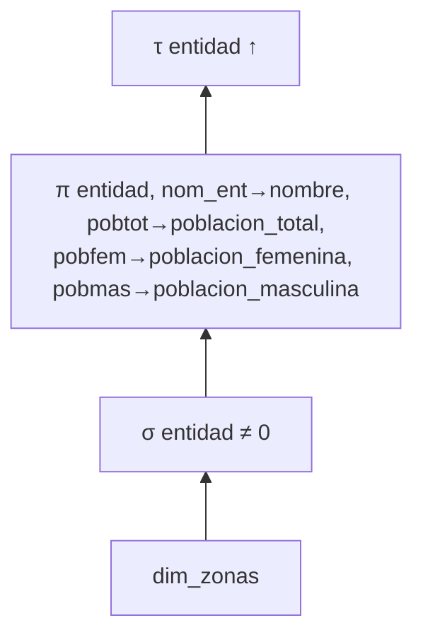
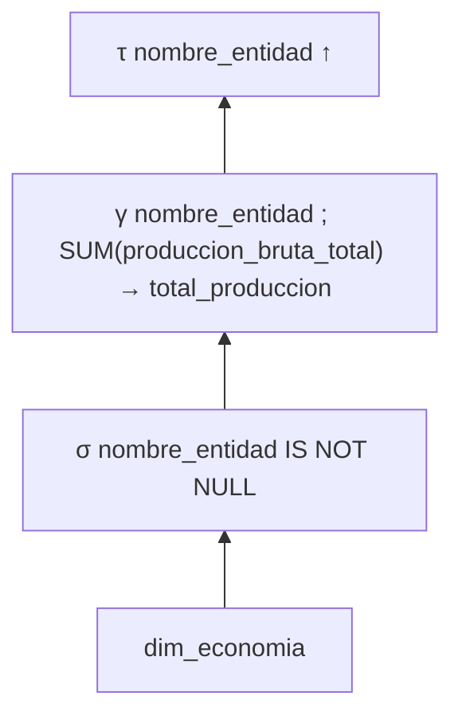
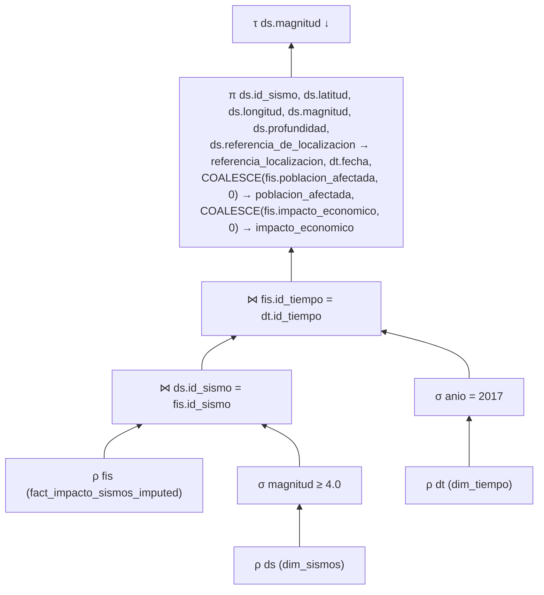

# Ejercicio 2.3 — Álgebra del proyecto asignado

**Responsable y autor:** Alejandro Rojas.  
**Estado:** álgebra, árboles y explicación completos; resultados obtenidos al ejecutar el SQL sobre la base de sismos.

## Fuentes y ejecución

Consultar los [fragmentos originales y su procedencia](../base/sismos/referencias/consultas-origen.md)
y el [esquema de sismos](../base/sismos/sql/00-datawarehouse_tables.sql).
Ejecutar las consultas en la base de sismos, no en HuellaRed. Mantener los bloques SQL de este documento
sincronizados con los archivos ejecutables si se modifica alguna consulta.

### Notación

Se usa el álgebra relacional extendida, porque el SQL incluye operaciones que el álgebra básica no tiene:

| Símbolo | Operación | Equivalente en SQL |
|---|---|---|
| σ<sub>c</sub>(R) | Selección: conserva las tuplas que cumplen `c` | `WHERE` |
| π<sub>L</sub>(R) | Proyección (generalizada): conserva o calcula las columnas de `L` | lista del `SELECT` |
| a → b | Renombramiento de un atributo dentro de la proyección | `a AS b` |
| ρ<sub>x</sub>(R) | Renombramiento de una relación | alias de tabla (`dim_sismos ds`) |
| R ⋈<sub>c</sub> S | Reunión theta con condición `c` | `JOIN … ON c` |
| γ<sub>G; F(a)→b</sub>(R) | Agrupación y agregación | `GROUP BY G` + `F(a) AS b` |
| τ<sub>a↑ / a↓</sub>(R) | Ordenamiento ascendente / descendente | `ORDER BY a [DESC]` |

Dos aclaraciones que aplican a las tres consultas:

- **Bolsas, no conjuntos.** SQL trabaja con multiconjuntos: el `SELECT` sin `DISTINCT` no elimina duplicados.
  Por eso π se interpreta aquí como proyección *sin* eliminación de duplicados. No se agregó `DISTINCT`
  en ninguna consulta, así que su semántica no se alteró.
- **τ no es un operador relacional puro.** Una relación no tiene orden; `ORDER BY` solo define el orden de
  presentación del resultado final. Por eso τ siempre aparece en la raíz del árbol y no cambia qué tuplas
  se devuelven, solo en qué orden se muestran.

## Consulta 01 — Población por entidad

**Pregunta:** ¿Qué población total, femenina y masculina tiene cada entidad con código distinto de cero?

**Origen:** [src/std2.php, líneas 260–268](https://github.com/GaelZamudio/Seismic-Data-Visualization-System/blob/8569667cf4f46fab640dba3f82a7b324ca7efaf7/src/std2.php#L260-L268).

**SQL ejecutable:** [01-consulta.sql](consultas/sismos/01-consulta.sql).

```sql
SELECT
entidad,
nom_ent AS nombre,
pobtot AS poblacion_total,
pobfem AS poblacion_femenina,
pobmas AS poblacion_masculina
FROM dim_zonas
WHERE entidad != 0
ORDER BY entidad;
```

### Expresión algebraica

```text
Z ← σ entidad ≠ 0 (dim_zonas)

P ← π entidad, nom_ent → nombre, pobtot → poblacion_total,
      pobfem → poblacion_femenina, pobmas → poblacion_masculina (Z)

Resultado ← τ entidad↑ (P)
```

En una sola línea:

τ<sub>entidad↑</sub>( π<sub>entidad, nom_ent→nombre, pobtot→poblacion_total, pobfem→poblacion_femenina, pobmas→poblacion_masculina</sub>( σ<sub>entidad ≠ 0</sub>(dim_zonas) ) )

**Renombramientos.** Los cuatro `AS` cambian solo el nombre de la columna en la salida; los valores no se
modifican. Se escriben como `a → b` dentro de la proyección. Equivalen a aplicar ρ sobre el resultado de π.

**ORDER BY.** `ORDER BY entidad` ordena por la clave numérica de la entidad (1 = Aguascalientes … 32 = Zacatecas).
Se representa con τ en la raíz.

### Árbol



### Operador principal

La **selección σ<sub>entidad ≠ 0</sub>** es la que hace el trabajo: es el único operador que tiene que revisar
todas las tuplas de `dim_zonas` y decidir cuáles pasan. La proyección solo recorta y renombra columnas de las
tuplas que ya pasaron, y τ ordena el resultado final. En estos datos la tabla es muy pequeña, así que el costo
de cualquiera de los tres operadores es mínimo. Esto es un razonamiento sobre el árbol, no una medición de
rendimiento.

### Resultado y observaciones

- **Filas devueltas:** 32, una por entidad federativa, de Aguascalientes (1) a Zacatecas (32).
- **Filtro `entidad != 0`:** en los datos cargados no hay ninguna fila con `entidad = 0`, por lo que hoy el filtro
  no descarta nada. Se conserva porque es parte de la consulta original del backend y protegería contra una
  fila de "total nacional" con código 0.
- **Duplicados:** la clave de `dim_zonas` es `id_zonas`, no `entidad`, así que en principio podría repetirse
  una entidad. En los datos actuales no ocurre: hay 32 filas y 32 entidades distintas.
- Ejemplo de filas: Jalisco (14), población total 8,348,151; México (15), población total 16,992,418.

Captura: [01-resultado.png](evidencias/sismos/2.3/01-resultado.png).

## Consulta 02 — Producción por entidad

**Pregunta:** ¿Cuál es la producción bruta total agrupada por nombre de entidad?

**Origen:** [src/aeconomica.php, líneas 60–64](https://github.com/GaelZamudio/Seismic-Data-Visualization-System/blob/8569667cf4f46fab640dba3f82a7b324ca7efaf7/src/aeconomica.php#L60-L64).

**SQL ejecutable:** [02-consulta.sql](consultas/sismos/02-consulta.sql).

```sql
SELECT nombre_entidad, SUM(produccion_bruta_total) as total_produccion
FROM dim_economia
WHERE nombre_entidad IS NOT NULL
GROUP BY nombre_entidad
ORDER BY nombre_entidad;
```

### Expresión algebraica

```text
E ← σ nombre_entidad IS NOT NULL (dim_economia)

G ← γ nombre_entidad ; SUM(produccion_bruta_total) → total_produccion (E)

Resultado ← τ nombre_entidad↑ (G)
```

En una sola línea:

τ<sub>nombre_entidad↑</sub>( γ<sub>nombre_entidad; SUM(produccion_bruta_total)→total_produccion</sub>( σ<sub>nombre_entidad IS NOT NULL</sub>(dim_economia) ) )

**Agrupación.** γ forma un grupo por cada valor distinto de `nombre_entidad` y, en cada grupo, suma
`produccion_bruta_total`. El resultado tiene exactamente los atributos `nombre_entidad` y `total_produccion`,
por eso no hace falta una π adicional: γ ya funciona como proyección.

**Renombramiento.** `as total_produccion` le da nombre a la columna calculada `SUM(...)`; se escribe como
`→ total_produccion` dentro de γ.

**Selección antes de agrupar.** `WHERE` se evalúa antes del `GROUP BY`, así que σ va debajo de γ en el árbol.
Si el filtro fuera sobre el resultado de la suma, se usaría `HAVING`, que sería una σ encima de γ.

**ORDER BY.** Ordena alfabéticamente por nombre de la entidad (τ en la raíz). El orden alfabético depende de la
intercalación (*collation*) de la base de datos. En la ejecución registrada, la intercalación ignora los acentos,
por lo que "México" aparece entre "Jalisco" y "Michoacán de Ocampo". Con otra intercalación (por ejemplo `C`),
los nombres acentuados podrían quedar en otra posición; las tuplas devueltas serían las mismas.

### Árbol



### Operador principal

La **agrupación γ** es el operador que hace el trabajo pesado: tiene que reunir todas las tuplas con el mismo
`nombre_entidad`, ya sea ordenándolas o con una tabla hash, y acumular la suma de cada grupo. La selección solo
descarta tuplas una por una, y τ ordena un resultado que ya está reducido a un renglón por entidad. Igual que en
la consulta 01, esto es un razonamiento sobre el árbol, no una medición.

### Resultado y observaciones

- **Filas devueltas:** 32, una por entidad.
- **El filtro no descarta nada hoy:** no hay ninguna fila con `nombre_entidad` nulo.
- **La agrupación no combina filas en los datos actuales:** `dim_economia` tiene 32 filas y 32 nombres distintos,
  así que cada grupo contiene una sola tupla y `total_produccion` es igual al valor original de esa fila.
  La consulta sigue siendo correcta: si se agregaran más registros de una entidad, por ejemplo de otro año,
  γ los sumaría.
- **SUM y NULL:** `SUM` ignora los valores nulos. Si todos los valores de un grupo fueran nulos, el resultado de
  ese grupo sería `NULL`, no 0.
- Ejemplo de filas: Ciudad de México 35,386,973.52; Nuevo León 16,042,716.066; Jalisco 10,854,723.374.
- Los nombres de esta tabla llevan acentos ("Ciudad de México", "Querétaro de Arteaga") y no coinciden
  textualmente con `dim_zonas.nom_ent` ("Ciudad de Mexico", "Queretaro"). No afecta a esta consulta, pero
  impediría reunir ambas tablas por nombre.

Captura: [02-resultado.png](evidencias/sismos/2.3/02-resultado.png).

## Consulta 03 — Sismos e impacto

**Pregunta:** ¿Qué sismos de magnitud al menos 4 ocurrieron en 2017 y qué impacto tienen registrado?

**Origen:** [src/std.php, líneas 282–297](https://github.com/GaelZamudio/Seismic-Data-Visualization-System/blob/8569667cf4f46fab640dba3f82a7b324ca7efaf7/src/std.php#L282-L297).
En el backend la magnitud y el año son parámetros (`$1`, `$2`). Se fijaron `$1 = 4.0` y `$2 = 2017`, sin cambios.

**SQL ejecutable:** [03-consulta.sql](consultas/sismos/03-consulta.sql).

```sql
SELECT
ds.id_sismo,
ds.latitud,
ds.longitud,
ds.magnitud,
ds.profundidad,
ds.referencia_de_localizacion AS referencia_localizacion,
dt.fecha,
COALESCE(fis.poblacion_afectada, 0) AS poblacion_afectada,
COALESCE(fis.impacto_economico, 0) AS impacto_economico
FROM dim_sismos ds
JOIN fact_impacto_sismos_imputed fis ON ds.id_sismo = fis.id_sismo
JOIN dim_tiempo dt ON fis.id_tiempo = dt.id_tiempo
WHERE ds.magnitud >= 4.0
AND dt.anio = 2017
ORDER BY ds.magnitud DESC;
```

### Expresión algebraica

**Traducción literal** (mismo orden que el SQL: primero las reuniones, después el `WHERE`):

```text
J  ← ( ρ ds(dim_sismos) ⋈ ds.id_sismo = fis.id_sismo ρ fis(fact_impacto_sismos_imputed) )
       ⋈ fis.id_tiempo = dt.id_tiempo ρ dt(dim_tiempo)

F  ← σ ds.magnitud ≥ 4.0 ∧ dt.anio = 2017 (J)

P  ← π ds.id_sismo, ds.latitud, ds.longitud, ds.magnitud, ds.profundidad,
       ds.referencia_de_localizacion → referencia_localizacion,
       dt.fecha,
       COALESCE(fis.poblacion_afectada, 0) → poblacion_afectada,
       COALESCE(fis.impacto_economico, 0) → impacto_economico (F)

Resultado ← τ ds.magnitud↓ (P)
```

**Forma equivalente con las selecciones empujadas hacia abajo.** Cada condición del `WHERE` usa atributos de una
sola relación, así que σ<sub>c1 ∧ c2</sub> se puede partir en σ<sub>c1</sub>(σ<sub>c2</sub>(…)) y cada parte se
puede bajar hasta su tabla. Esto se hace antes de reunir, sin cambiar el resultado:

```text
S  ← σ magnitud ≥ 4.0 (ρ ds(dim_sismos))
T  ← σ anio = 2017   (ρ dt(dim_tiempo))

J' ← ( S ⋈ ds.id_sismo = fis.id_sismo ρ fis(fact_impacto_sismos_imputed) ) ⋈ fis.id_tiempo = dt.id_tiempo T

Resultado ← τ ds.magnitud↓ ( π …misma lista que arriba… (J') )
```

**Renombramientos.** Los alias `ds`, `fis` y `dt` son renombramientos de relación (ρ). Sirven para calificar los
atributos repetidos, como `id_sismo` en `dim_sismos` y en la tabla de hechos. `AS referencia_localizacion` renombra un
atributo. Los dos `AS` que van después de `COALESCE` le dan nombre a columnas calculadas.

**Reunión theta y no natural.** Se usa ⋈ con condición explícita, igual que el `JOIN … ON`. Una reunión natural
también funcionaría en este caso, porque los atributos comunes son justamente `id_sismo` e `id_tiempo`. Aun así,
la reunión theta es la traducción fiel del SQL y no depende de que coincidan los nombres de columna.

**COALESCE.** `COALESCE(x, 0)` devuelve `x` si no es nulo y 0 si lo es. No existe en el álgebra básica, así que se
representa como una expresión calculada dentro de la proyección generalizada π. No filtra ni elimina tuplas;
solo cambia el valor que se muestra.

**ORDER BY.** `ORDER BY ds.magnitud DESC` presenta primero los sismos más fuertes (τ descendente en la raíz).
Los sismos con la misma magnitud no tienen un orden definido entre ellos, porque no hay un segundo criterio de
ordenamiento. Dos ejecuciones podrían mostrarlos en distinto orden aunque devuelvan las mismas tuplas.

### Árbol

Árbol optimizado, con las selecciones empujadas hacia las hojas:



En la traducción literal el árbol es el mismo, pero con una sola σ<sub>magnitud ≥ 4.0 ∧ anio = 2017</sub>
colocada encima de las dos reuniones.

### Operador principal

Las **reuniones ⋈** hacen el trabajo pesado. Son el único lugar donde se combinan tuplas de tres relaciones
distintas. La tabla de hechos entra completa (196,576 filas, ya que no tiene filtro propio). `dim_sismos` y
`dim_tiempo` tienen 319,592 filas cada una, pero las selecciones las reducen antes de reunir: quedan 47,259
sismos con magnitud ≥ 4.0 y 26,563 registros de tiempo de 2017. Las selecciones solo revisan tuplas una
por una, y la proyección y τ trabajan sobre el resultado ya reducido.

Esto explica por qué conviene empujar las selecciones: cada σ que baja hacia una hoja reduce cuántas tuplas
entran a la reunión. En el árbol literal, en cambio, la reunión se haría con todas las tuplas y se filtraría
hasta el final. El plan que muestra `EXPLAIN` en PostgreSQL aplica justamente el filtro `anio = 2017` sobre
`dim_tiempo` antes de reunir. Esto describe el plan elegido por el optimizador; no es una medición de tiempo.

### Resultado y observaciones

Parámetros: magnitud mínima 4.0, año 2017, sin cambios.

- **Filas devueltas:** 2,880 sismos distintos, con magnitudes de 4.0 a 7.1.
- **Primera fila:** sismo 94787, magnitud 7.1, del 2017-09-19, "8 km al NOROESTE de CHIAUTLA DE TAPIA, PUE"
  (el sismo del 19 de septiembre de 2017). Población afectada 6,583,278; impacto económico 5,256,714.704.
- **La reunión interna deja fuera sismos sin hechos.** `dim_sismos` tiene 319,592 sismos, pero 123,016 no tienen
  ninguna fila en `fact_impacto_sismos_imputed`. Como `JOIN` es una reunión interna, esos sismos no aparecen. El
  caso más visible es el sismo 91665 de magnitud 8.2 del 2017-09-07 ("140 km al SUROESTE de PIJIJIAPAN, CHIS"):
  cumple los dos filtros, pero no aparece en el resultado porque no tiene impacto registrado. Por eso la magnitud
  máxima del resultado es 7.1 y no 8.2. No se cambió la consulta. Si se quisiera incluirlos, habría que usar una
  reunión externa izquierda (⟕) desde `dim_sismos`, y eso cambiaría la semántica de la consulta original.
- **COALESCE no cambia ningún valor hoy:** no hay nulos en `poblacion_afectada` ni en `impacto_economico`.
  Además, con reunión interna toda tupla del resultado tiene fila de hechos. `COALESCE` solo actuaría si esas
  columnas tuvieran nulos, o si la reunión fuera externa y faltara la fila de hechos.
- **Duplicados:** la tabla de hechos no declara clave primaria, así que un sismo podría aparecer más de una vez.
  En el resultado no pasa: las 2,880 filas tienen 2,880 `id_sismo` distintos. No se agregó `DISTINCT`.
- **Empates en el orden:** el resultado tiene solo 20 magnitudes distintas para 2,880 filas, así que hay muchos
  empates cuyo orden relativo no está garantizado (ver ORDER BY).

Capturas: [03-resultado.png](evidencias/sismos/2.3/03-resultado.png) (primeras filas) y [03-resultado-final.png](evidencias/sismos/2.3/03-resultado-final.png) (últimas filas y total de 2,880).

## Revisión final

- [x] Las tres consultas conservan su origen verificable.
- [x] Cada una tiene álgebra, árbol y explicación del operador principal.
- [x] Se explican agrupación, renombramientos, COALESCE y ORDER BY cuando aparecen.
- [x] Los resultados corresponden a ejecuciones reales; no se alteraron filtros o duplicados sin documentarlo.
