# 2.2 Consultas del equipo — HuellaRed

**Responsable:** Gael Zamudio. Borrador elaborado con Claude; revisión e integración asistidas por Codex.

**Muestra:** [grupo.txt](relax/grupo.txt), 23 relaciones y 348 filas.

**Ejecución:** cargar el grupo en RelaX. En una sesión nueva de pgAdmin ejecutar primero [muestra.sql](relax/muestra.sql) y después cada SQL enlazado abajo, sin cambiar de sesión. Las tablas temporales ocultan las tablas completas de `public`; no ejecutar estas consultas con `public.` para esta comparación.

**Verificación, 22 de noviembre de 2026:** las 13 consultas se ejecutaron en una base aislada con PostgreSQL 18.6 y sus expresiones se evaluaron con el motor oficial de [RelaX](https://github.com/dbis-uibk/relax), sin interfaz gráfica. Coincidieron todas las filas, no solo sus cantidades, comparando sin orden y normalizando la representación de números y fechas. Los resultados completos están en [resultados.json](consultas/huellared/resultados.json). No se modificó la base operativa ni la muestra.

**Alcance:** los resultados describen exclusivamente esta muestra. La ausencia de una adopción o vacuna no demuestra que nunca haya ocurrido en la base completa. La consulta 09 verifica compatibilidad por especie, no cupo ni disponibilidad del hogar; la 10 muestra historial, no estado actual de adopción. `ORDER BY` solo cambia la presentación.

**Evidencias:** las capturas de RelaX se incluyen en cada consulta. Cuando hay varias partes, se presentan juntas y en orden.

## 01 · Selección σ

**Pregunta:** ¿Qué animales están disponibles para adopción?

**Álgebra (RelaX):**
```
σ estado_actual = 'disponible_adopcion' (animal)
```

**SQL:** [01-seleccion.sql](consultas/huellared/01-seleccion.sql)
```sql
SELECT *
FROM animal
WHERE estado_actual = 'disponible_adopcion';
```

**Resultado verificado:** 5 fila(s)

**Qué demuestra:** La selección filtra filas y conserva todas las columnas.

**Comparación SQL/álgebra:** coinciden todas las filas.

**Evidencia de RelaX:**

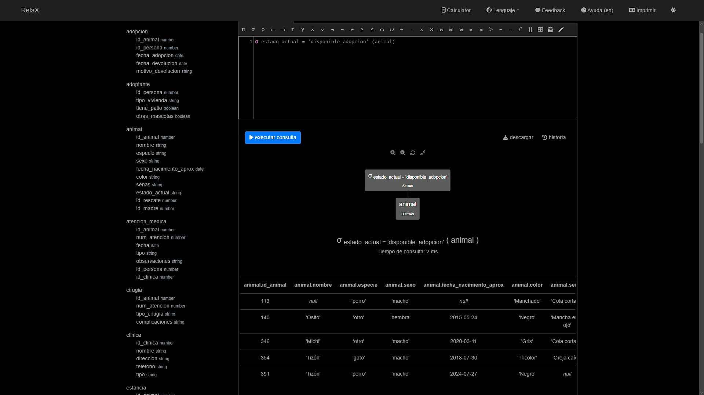

## 02 · Proyección π

**Pregunta:** ¿Qué combinaciones distintas de especie y color existen entre los animales?

**Álgebra (RelaX):**
```
π especie, color (animal)
```

**SQL:** [02-proyeccion.sql](consultas/huellared/02-proyeccion.sql)
```sql
SELECT DISTINCT especie, color
FROM animal;
```

**Resultado verificado:** 20 fila(s)

**Qué demuestra:** La proyección filtra columnas y elimina duplicados: 30 animales dan 20 combinaciones. En SQL hace falta DISTINCT para igualar el álgebra.

**Comparación SQL/álgebra:** coinciden todas las filas.

**Evidencia de RelaX:** las siguientes partes corresponden a la misma consulta.

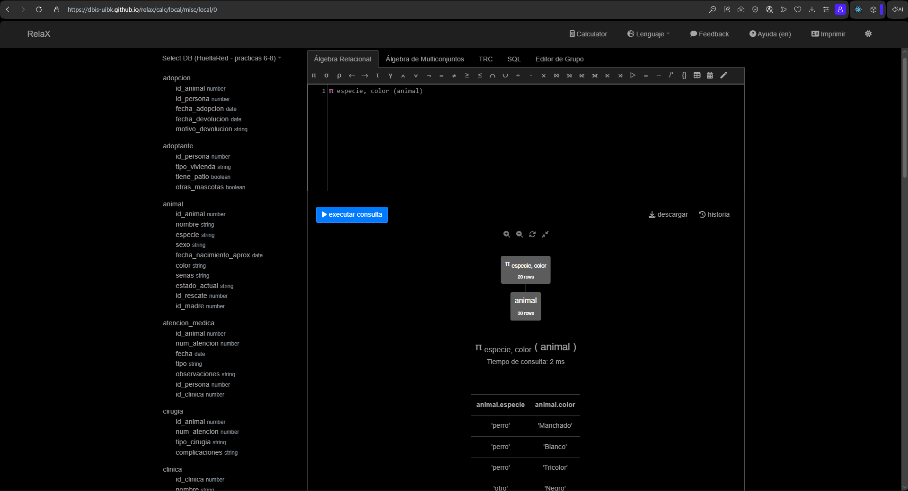

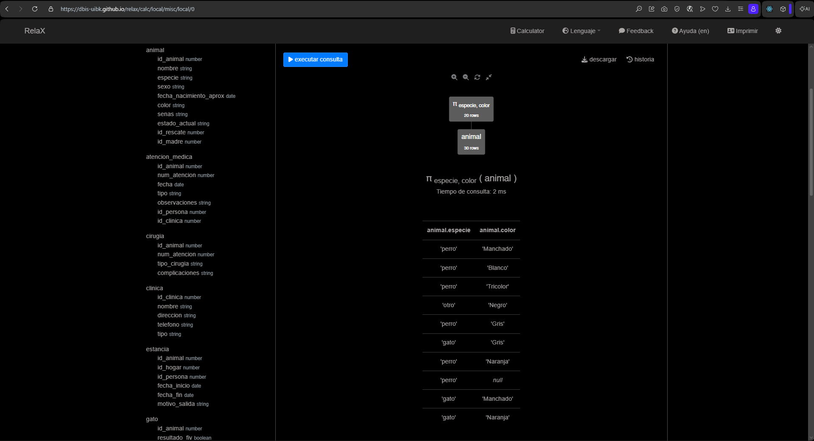

## 03 · Composición σ + π

**Pregunta:** ¿Cómo se llaman y de qué sexo son los perros que están en atención médica?

**Álgebra (RelaX):**
```
perros_en_atencion = σ especie = 'perro' and estado_actual = 'en_atencion' (animal)
π nombre, sexo (perros_en_atencion)
```

**SQL:** [03-composicion.sql](consultas/huellared/03-composicion.sql)
```sql
SELECT DISTINCT nombre, sexo
FROM animal
WHERE especie = 'perro' AND estado_actual = 'en_atencion';
```

**Resultado verificado:** 3 fila(s)

**Qué demuestra:** Primero se filtra y luego se proyecta: si se proyectara antes, especie y estado_actual ya no existirían para filtrar.

**Comparación SQL/álgebra:** coinciden todas las filas.

**Evidencia de RelaX:** las siguientes partes corresponden a la misma consulta.

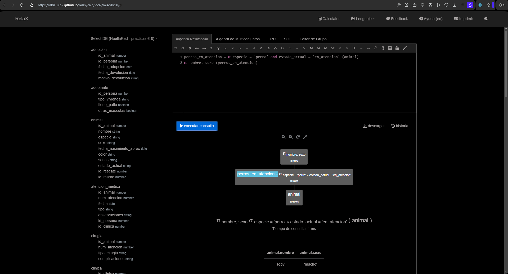

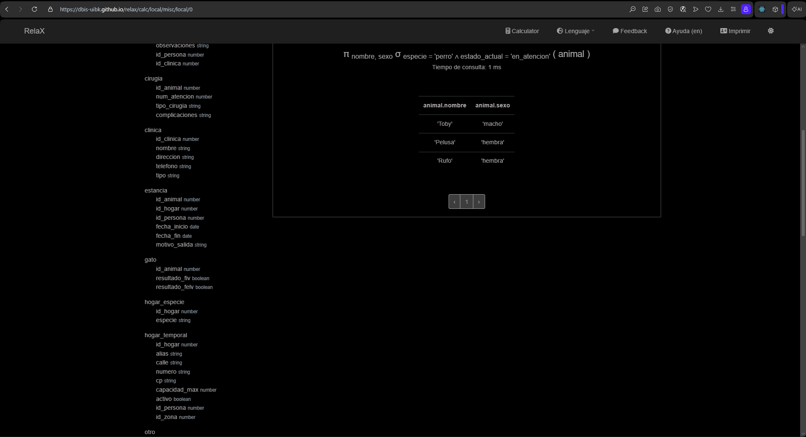

## 04 · Unión ∪

**Pregunta:** ¿Qué personas participan en la red como rescatistas o como adoptantes?

**Álgebra (RelaX):**
```
π id_persona (rescatista) ∪ π id_persona (adoptante)
```

**SQL:** [04-union.sql](consultas/huellared/04-union.sql)
```sql
SELECT id_persona FROM rescatista
UNION
SELECT id_persona FROM adoptante;
```

**Resultado verificado:** 19 fila(s)

**Qué demuestra:** Compatibilidad de unión: ambas relaciones quedan con un solo atributo id_persona del mismo dominio (numérico). La persona 85 está en las dos y aparece una sola vez.

**Comparación SQL/álgebra:** coinciden todas las filas.

**Evidencia de RelaX:** las siguientes partes corresponden a la misma consulta.

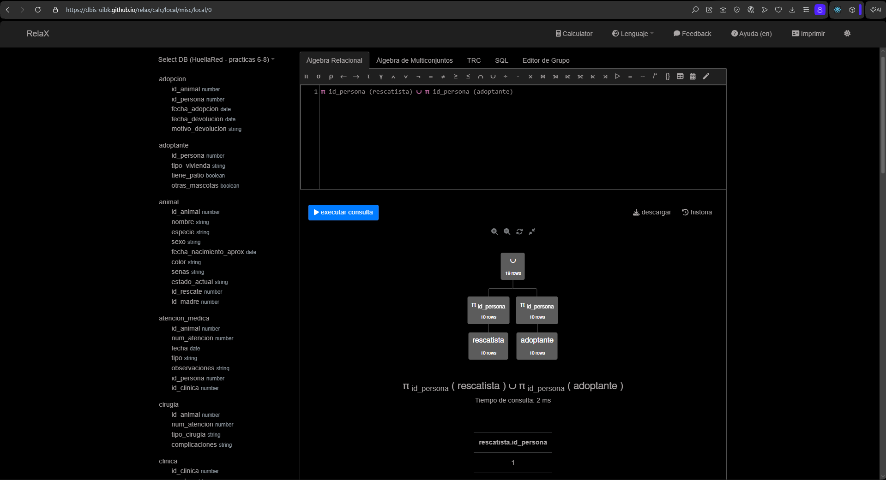

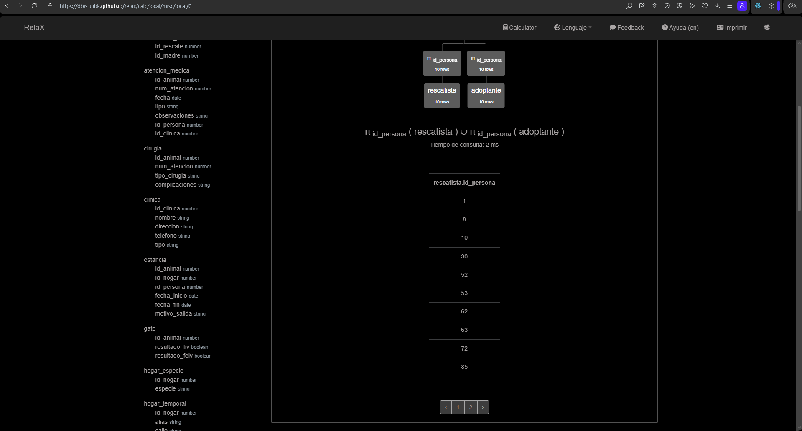

## 05 · Diferencia -

**Pregunta:** ¿Qué adoptantes no tienen adopciones registradas en la muestra?

**Álgebra (RelaX):**
```
π id_persona (adoptante) - π id_persona (adopcion)
```

**SQL:** [05-diferencia.sql](consultas/huellared/05-diferencia.sql)
```sql
SELECT id_persona FROM adoptante
EXCEPT
SELECT id_persona FROM adopcion;
```

**Resultado verificado:** 5 fila(s)

**Qué demuestra:** Se resta adopción de adoptante. El orden importa: adopción - adoptante daría vacío, porque toda adopción pertenece a un adoptante (llave foránea).

**Comparación SQL/álgebra:** coinciden todas las filas.

**Evidencia de RelaX:** las siguientes partes corresponden a la misma consulta.

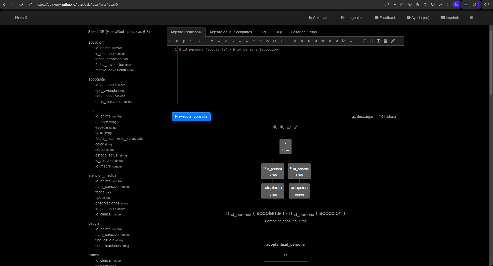

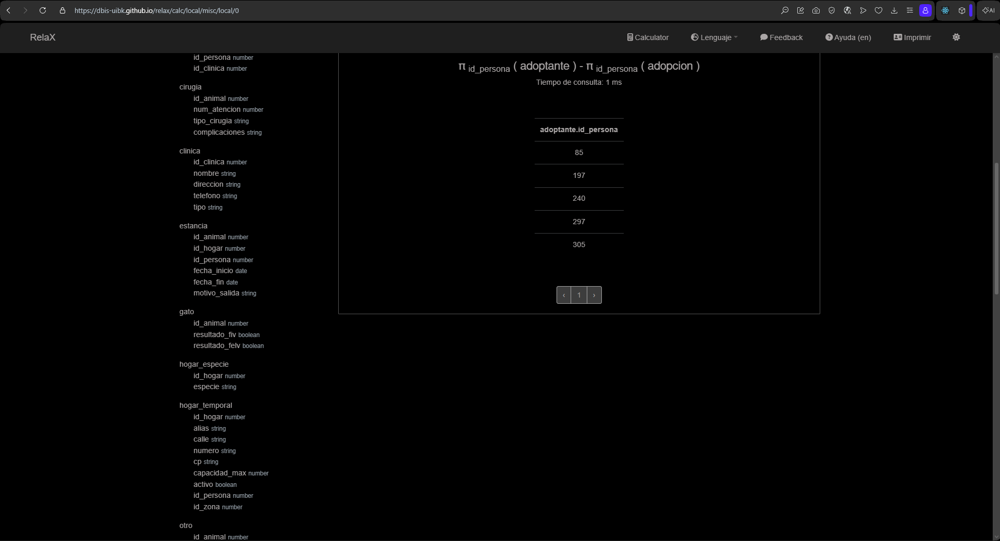

## 06 · Intersección ∩

**Pregunta:** ¿Qué personas son a la vez rescatistas y adoptantes?

**Álgebra (RelaX):**
```
π id_persona (rescatista) ∩ π id_persona (adoptante)
```

**SQL:** [06-interseccion.sql](consultas/huellared/06-interseccion.sql)
```sql
SELECT id_persona FROM rescatista
INTERSECT
SELECT id_persona FROM adoptante;
```

**Resultado verificado:** 1 fila(s)

**Qué demuestra:** Mismos atributos y tipos que la consulta 04. Comprobación: |A ∪ B| = |A| + |B| - |A ∩ B| → 19 = 10 + 10 - 1.

**Comparación SQL/álgebra:** coinciden todas las filas.

**Evidencia de RelaX:**

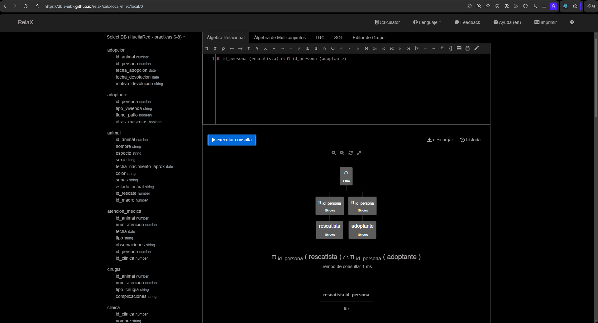

## 07 · Producto cartesiano cross join

**Pregunta:** ¿Qué parejas animal disponible–adoptante con patio podrían formarse?

**Álgebra (RelaX):**
```
disponibles = σ estado_actual = 'disponible_adopcion' (animal)
con_patio = σ tiene_patio = true (adoptante)
π id_animal, nombre, id_persona (disponibles cross join con_patio)
```

**SQL:** [07-producto-cartesiano.sql](consultas/huellared/07-producto-cartesiano.sql)
```sql
SELECT a.id_animal, a.nombre, d.id_persona
FROM animal a CROSS JOIN adoptante d
WHERE a.estado_actual = 'disponible_adopcion' AND d.tiene_patio;
```

**Resultado verificado:** 30 fila(s)

**Qué demuestra:** Cada animal se empareja con cada adoptante: 5 cross join 6 = 30 filas. Sin una condición que relacione a las dos (una solicitud, compatibilidad de tamaño) las parejas no significan nada, por eso casi siempre se combina con una selección y se convierte en reunión.

**Comparación SQL/álgebra:** coinciden todas las filas.

**Evidencia de RelaX:** las siguientes partes corresponden a la misma consulta.

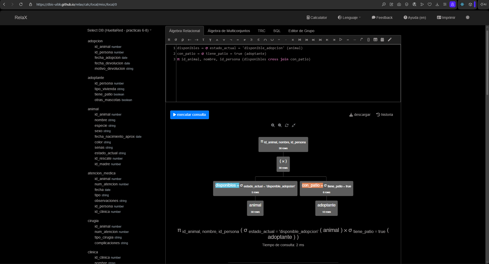

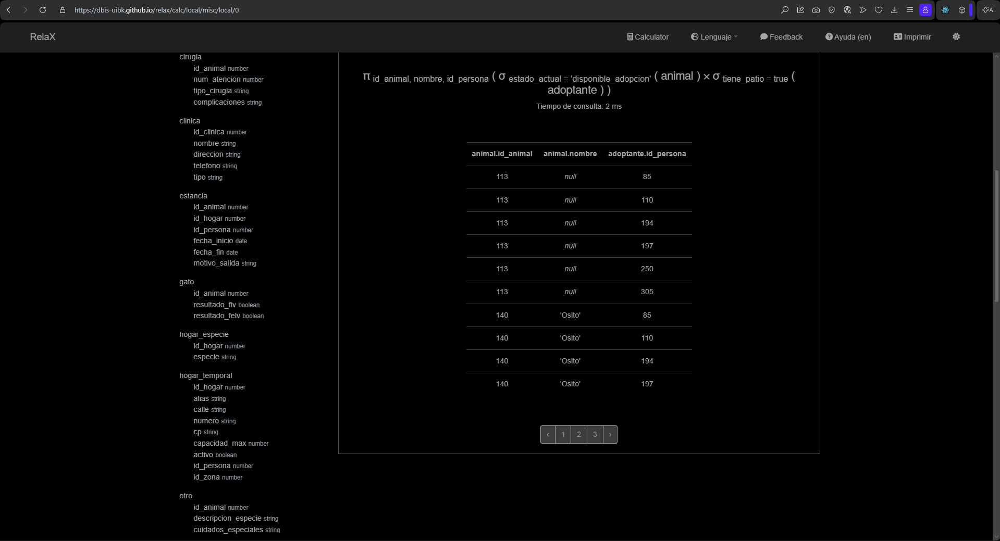

## 08 · Reunión natural ⨝

**Pregunta:** ¿Qué adopciones se han registrado, con el animal y la persona que adoptó?

**Álgebra (RelaX):**
```
π id_animal, especie, nombres, ap_paterno, fecha_adopcion (adopcion ⨝ animal ⨝ persona)
```

**SQL:** [08-reunion-natural.sql](consultas/huellared/08-reunion-natural.sql)
```sql
SELECT DISTINCT d.id_animal, a.especie, p.nombres, p.ap_paterno, d.fecha_adopcion
FROM adopcion d
JOIN animal a ON a.id_animal = d.id_animal
JOIN persona p ON p.id_persona = d.id_persona;
```

**Resultado verificado:** 10 fila(s)

**Qué demuestra:** Se conservan solo las filas que coinciden en id_animal e id_persona. Se pierden los 21 animales sin adopción y las personas sin adopciones en la muestra.

**Comparación SQL/álgebra:** coinciden todas las filas.

**Evidencia de RelaX:** las siguientes partes corresponden a la misma consulta.

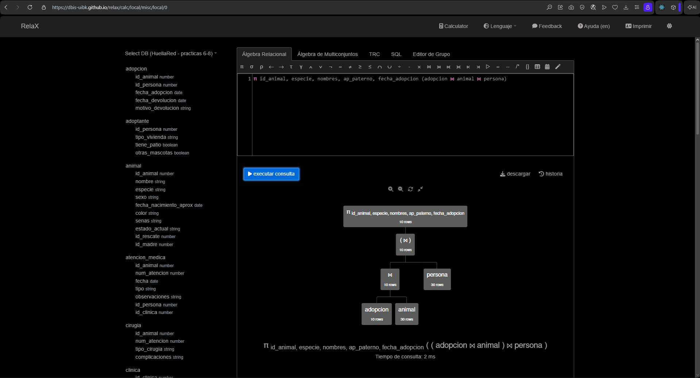

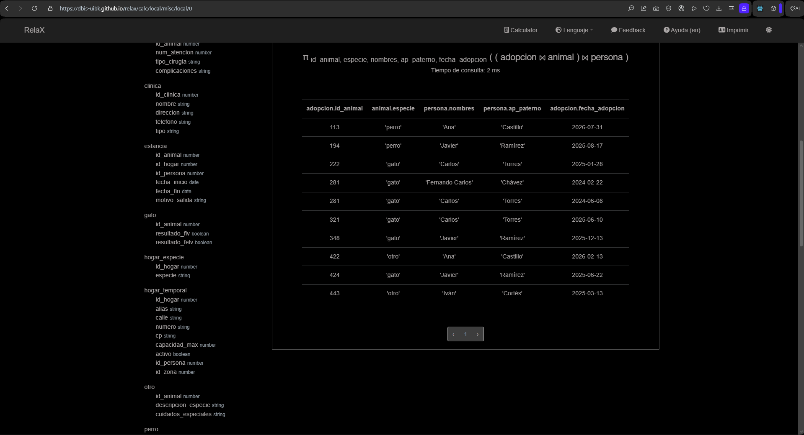

## 09 · Reunión theta ⨝θ

**Pregunta:** ¿A qué hogares temporales podría pasar cada animal en atención, según las especies que el hogar acepta?

**Álgebra (RelaX):**
```
hogares = ρ especie_hogar ← especie (hogar_especie)
en_atencion = σ estado_actual = 'en_atencion' (animal)
π id_animal, nombre, especie, id_hogar (en_atencion ⨝ especie = especie_hogar hogares)
```

**SQL:** [09-reunion-theta.sql](consultas/huellared/09-reunion-theta.sql)
```sql
SELECT DISTINCT a.id_animal, a.nombre, a.especie, he.id_hogar
FROM animal a
JOIN hogar_especie he ON a.especie = he.especie
WHERE a.estado_actual = 'en_atencion';
```

**Resultado verificado:** 19 fila(s)

**Qué demuestra:** Se especifica explícitamente la condición especie = especie_hogar: es una reunión theta de igualdad. La reunión natural compara todos los atributos homónimos y no requiere una FK. Se renombra especie para hacer explícita la comparación. Un animal en atención cuya especie ningún hogar acepta no aparecería; en esta muestra los 6 tienen al menos un hogar compatible.

**Comparación SQL/álgebra:** coinciden todas las filas.

**Evidencia de RelaX:** las siguientes partes corresponden a la misma consulta.

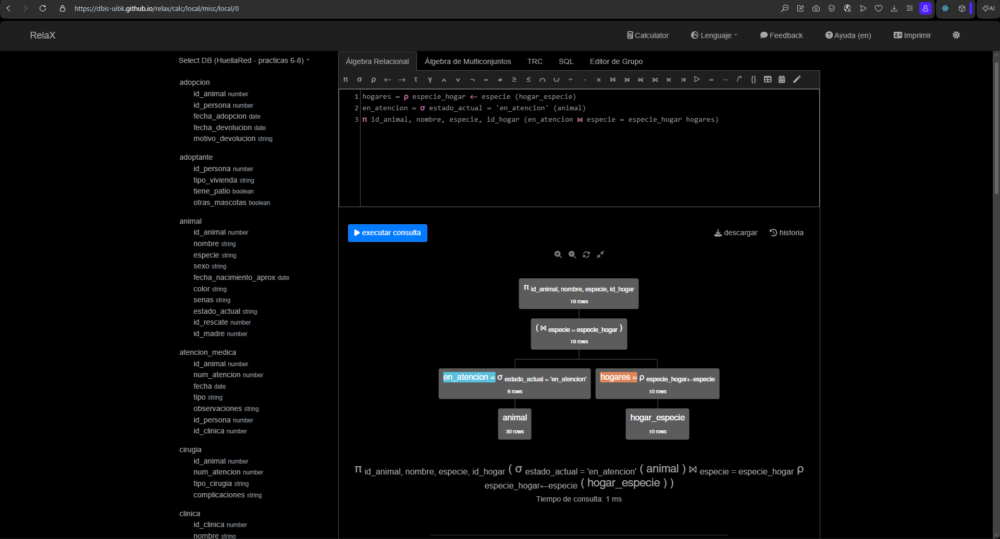

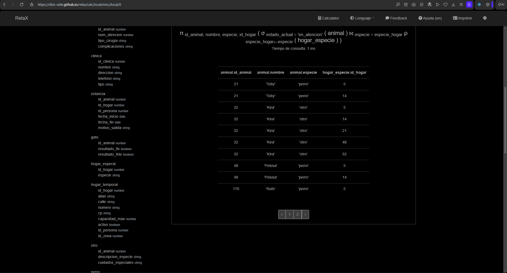

## 10 · Reunión externa ⟕

**Pregunta:** ¿Qué registros de adopción tiene cada animal de la muestra, incluidos aquellos sin registros?

**Álgebra (RelaX):**
```
π id_animal, nombre, id_persona, fecha_adopcion (animal ⟕ adopcion)
```

**SQL:** [10-reunion-externa.sql](consultas/huellared/10-reunion-externa.sql)
```sql
SELECT a.id_animal, a.nombre, d.id_persona, d.fecha_adopcion
FROM animal a
LEFT JOIN adopcion d ON a.id_animal = d.id_animal;
```

**Resultado verificado:** 31 fila(s)

**Qué demuestra:** Conserva todos los animales: los animales sin registros de adopción en la muestra salen con NULL en id_persona y fecha_adopcion. Contrasta con la consulta 08, que los pierde.

**Comparación SQL/álgebra:** coinciden todas las filas.

**Evidencia de RelaX:** las siguientes partes corresponden a la misma consulta.

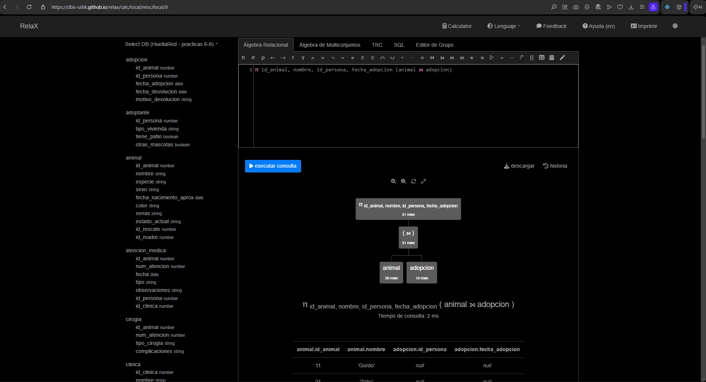

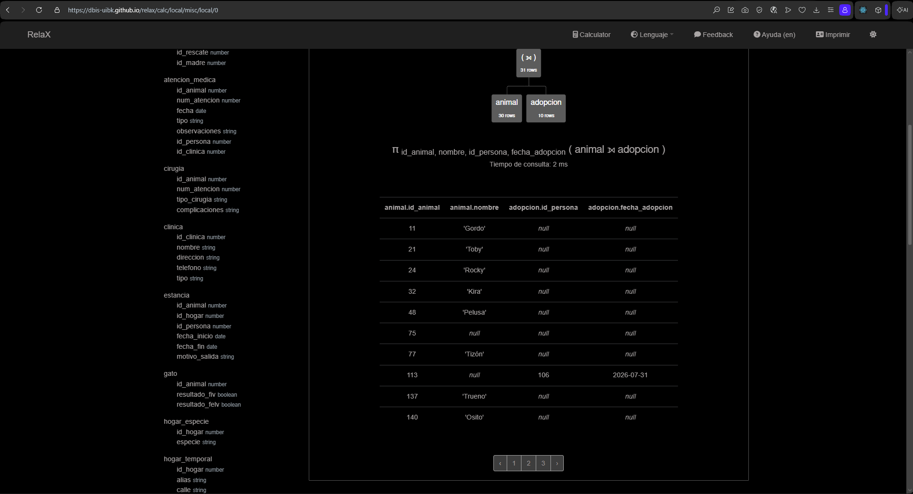

## 11 · Agrupación γ

**Pregunta:** ¿Cuántos animales hay en cada estado del proceso de rescate?

**Álgebra (RelaX):**
```
γ estado_actual; count(*) -> total (animal)
```

**SQL:** [11-agrupacion-a.sql](consultas/huellared/11-agrupacion-a.sql)
```sql
SELECT estado_actual, COUNT(*) AS total
FROM animal
GROUP BY estado_actual
ORDER BY total DESC;
```

**Resultado verificado:** 5 fila(s)

**Qué demuestra:** Un resumen por grupo: cinco grupos (uno por estado), con 12 animales adoptados como el grupo mayor.

**Comparación SQL/álgebra:** coinciden todas las filas.

**Evidencia de RelaX:** las siguientes partes corresponden a la misma consulta.

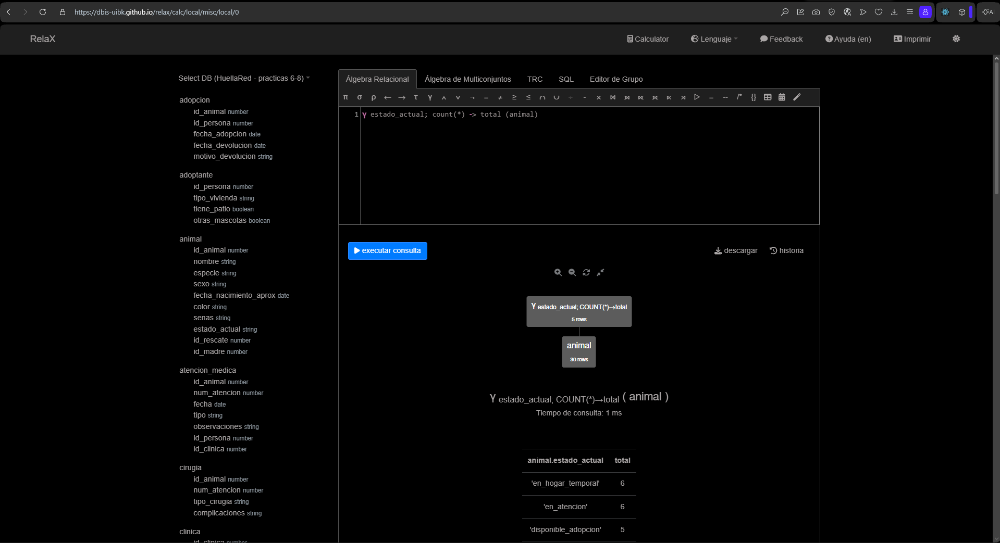

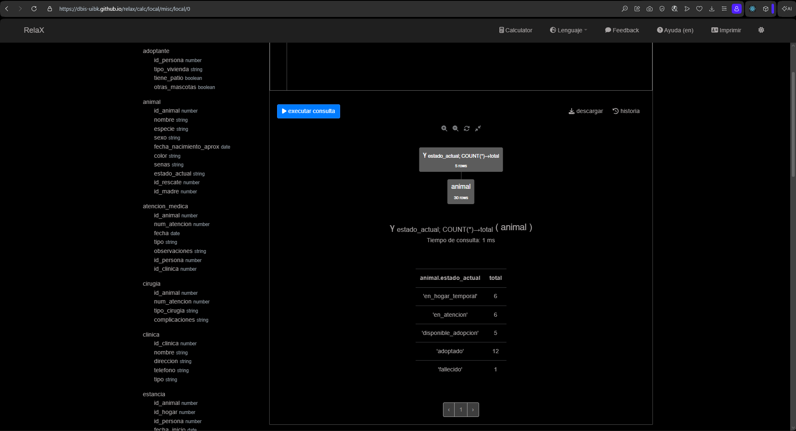

## 12 · Agrupación γ

**Pregunta:** ¿Cuántos casos, días totales y duración máxima de tratamiento hay por diagnóstico?

**Álgebra (RelaX):**
```
γ diagnostico; count(*) -> casos, sum(duracion_dias) -> dias_total, max(duracion_dias) -> mas_largo (tratamiento)
```

**SQL:** [12-agrupacion-b.sql](consultas/huellared/12-agrupacion-b.sql)
```sql
SELECT diagnostico, COUNT(*) AS casos, SUM(duracion_dias) AS dias_total, MAX(duracion_dias) AS mas_largo
FROM tratamiento
GROUP BY diagnostico
ORDER BY casos DESC, diagnostico;
```

**Resultado verificado:** 4 fila(s)

**Qué demuestra:** Cuatro grupos. La sarna sarcóptica es la más frecuente (4 casos); la desnutrición tiene los tratamientos más largos (hasta 60 días).

**Comparación SQL/álgebra:** coinciden todas las filas.

**Evidencia de RelaX:** las siguientes partes corresponden a la misma consulta.

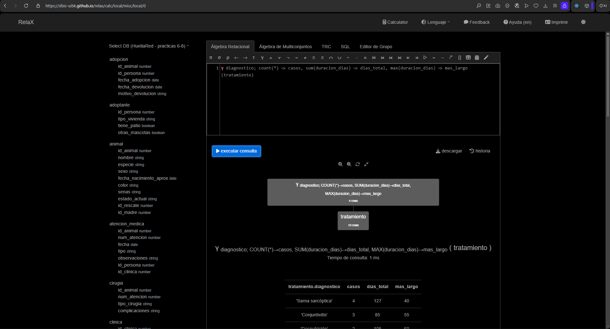

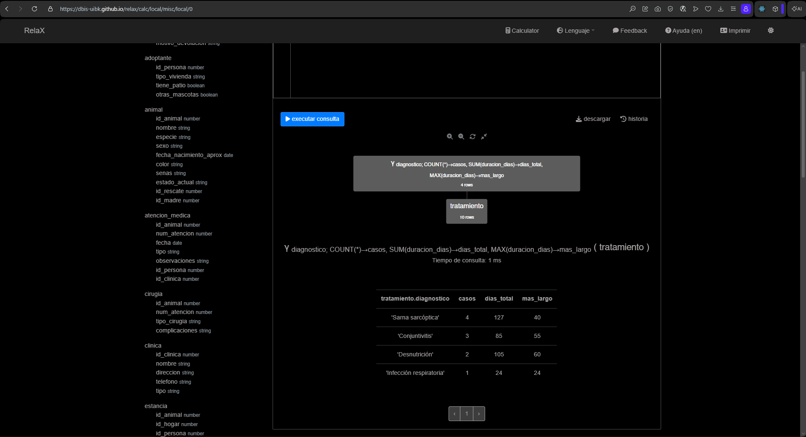

## 13 · División ÷

**Pregunta:** ¿Qué hogares aceptan todas las especies presentes en la muestra de animales?

**Álgebra (RelaX):**
```
especies = π especie (animal)
hogar_especie ÷ especies
```

**SQL:** [13-division.sql](consultas/huellared/13-division.sql)
```sql
SELECT DISTINCT h.id_hogar
FROM hogar_especie h
WHERE NOT EXISTS (
    SELECT 1 FROM (SELECT DISTINCT especie FROM animal) e
    WHERE NOT EXISTS (
        SELECT 1 FROM hogar_especie x
        WHERE x.id_hogar = h.id_hogar AND x.especie = e.especie));
-- Equivalente con conteo:
-- SELECT id_hogar FROM hogar_especie
-- WHERE especie IN (SELECT especie FROM animal)
-- GROUP BY id_hogar
-- HAVING COUNT(DISTINCT especie) = (SELECT COUNT(DISTINCT especie) FROM animal);
```

**Resultado verificado:** 1 fila(s)

**Qué demuestra:** Divisor = {perro, gato, otro}, derivado de los datos. «Para todo» se expresa con doble NOT EXISTS: no existe una especie del divisor que el hogar no acepte.

**Comparación SQL/álgebra:** coinciden todas las filas.

**Evidencia de RelaX:**

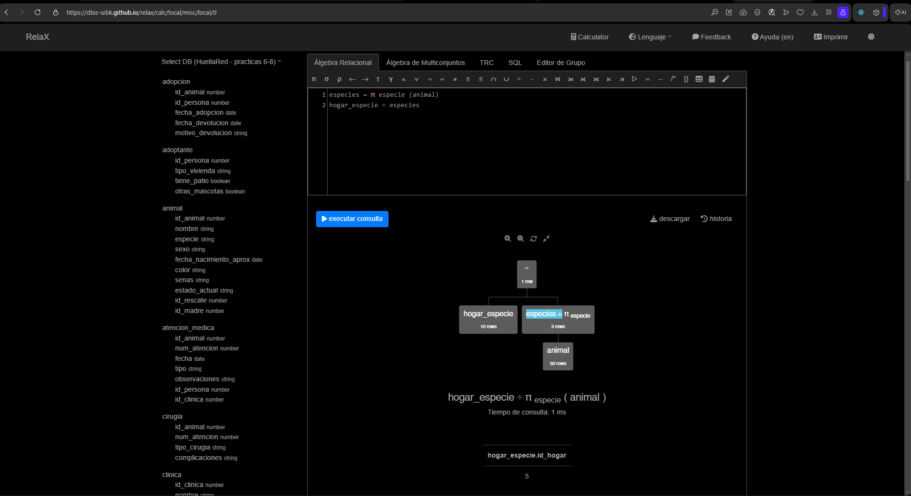
