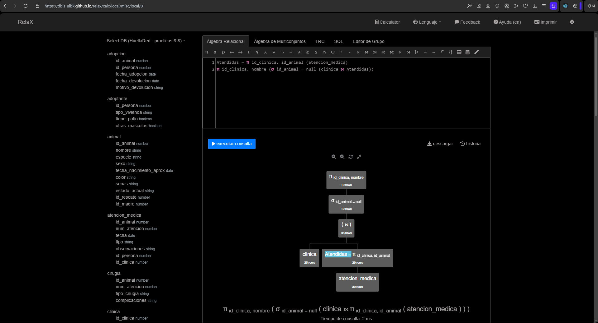
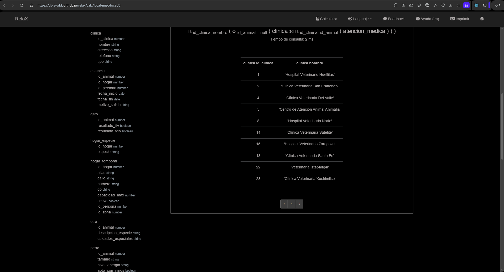
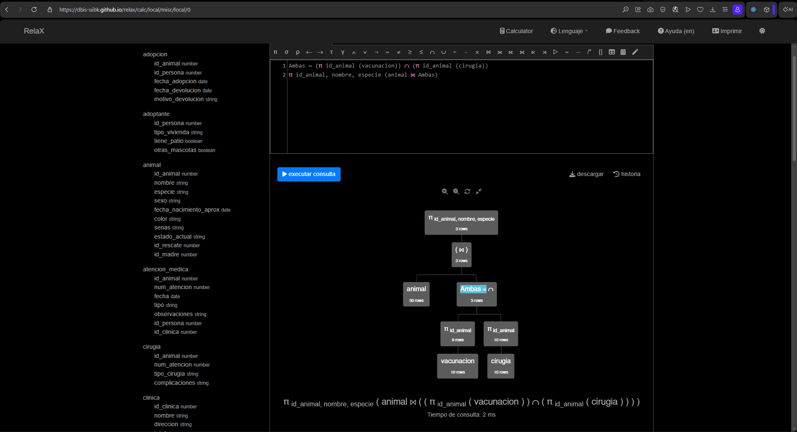
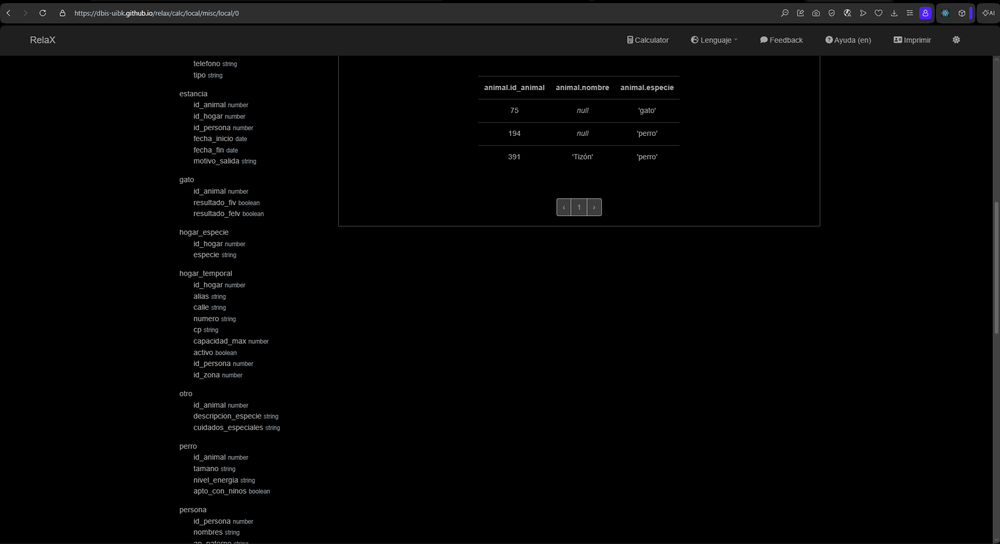
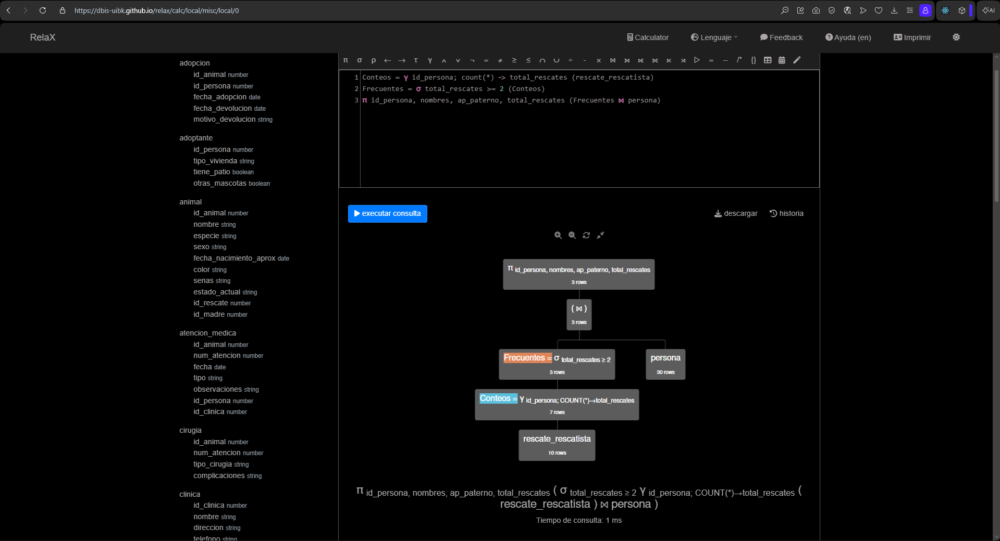
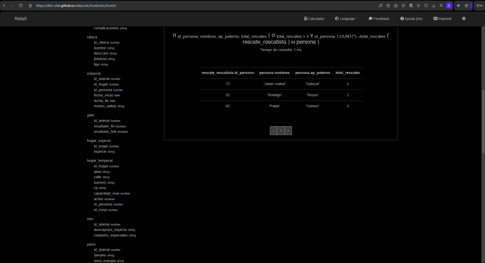

# Trabajo individual — Gael Zamudio

**Responsable:** Gael Zamudio (`GaelZamudio`). **SQL:** [GaelZamudio.sql](GaelZamudio.sql).

Tres consultas propias sobre la muestra compartida de HuellaRed. La consulta 1 utiliza reunión externa izquierda. 

## Datos y comprobación

Cargar [grupo.txt](../relax/grupo.txt) en RelaX. En una sesión nueva de pgAdmin ejecutar primero [muestra.sql](../relax/muestra.sql) y después el SQL individual, sin cambiar de sesión ni calificar las tablas con `public.`. Así ambos sistemas consultan las mismas 23 relaciones y 348 filas.

## Consulta 1 — ¿Qué clínicas no tienen atenciones médicas registradas en la muestra?

**Operadores:** Reunión externa izquierda, selección y proyección.

**Álgebra (RelaX):**

```text
Atendidas = π id_clinica, id_animal (atencion_medica)
π id_clinica, nombre (σ id_animal = null (clinica ⟕ Atendidas))
```

La reunión externa izquierda conserva todas las clínicas. Cuando no hay una atención asociada, id_animal queda en NULL; ese campo es obligatorio en una atención, por lo que permite reconocer la ausencia de coincidencia.

Antes de la reunión algebraica se proyectan únicamente id_clinica e id_animal. Esto evita unir también por `tipo`: clinica.tipo describe la clase de clínica, mientras que atencion_medica.tipo describe la atención. Una reunión natural directa entre las tablas completas compararía ambos atributos homónimos y sería incorrecta. SQL especifica únicamente la igualdad de id_clinica.

En RelaX el filtro es `id_animal = null`; en PostgreSQL se expresa con `IS NULL`. El resultado significa ausencia de atenciones **en la muestra**, no inactividad real de esas clínicas.

**SQL equivalente:**

```sql
SELECT c.id_clinica, c.nombre
FROM clinica c
LEFT JOIN atencion_medica am ON am.id_clinica = c.id_clinica
WHERE am.id_animal IS NULL
ORDER BY c.id_clinica;
```

**Resultado verificado:** 10 filas, iguales en SQL y álgebra.

| id_clinica | nombre |
|---|---|
| 1 | Hospital Veterinario Huellitas |
| 2 | Clínica Veterinaria San Francisco |
| 4 | Clínica Veterinaria Del Valle |
| 5 | Centro de Atención Animal Animalia |
| 8 | Hospital Veterinario Norte |
| 14 | Clínica Veterinaria Satélite |
| 15 | Hospital Veterinario Zaragoza |
| 18 | Clínica Veterinaria Santa Fe |
| 22 | Veterinaria Iztapalapa |
| 23 | Clínica Veterinaria Xochimilco |

**Evidencia de RelaX:** las siguientes partes corresponden a la misma consulta.





## Consulta 2 — ¿Qué animales tienen tanto vacunaciones como cirugías registradas en la muestra?

**Operadores:** Proyección, intersección y reunión natural.

**Álgebra (RelaX):**

```text
Ambas = (π id_animal (vacunacion)) ∩ (π id_animal (cirugia))
π id_animal, nombre, especie (animal ⨝ Ambas)
```

Se proyectan los identificadores de animales de vacunacion y cirugia. La intersección conserva los que aparecen en ambos conjuntos; después se reúnen con animal para obtener nombre y especie. Las dos atenciones pueden haber ocurrido en fechas diferentes. No se afirma que fueran simultáneas.

INTERSECT elimina duplicados en SQL, como la intersección algebraica: un animal con varias vacunaciones y cirugías aparece una sola vez. Los nombres NULL se conservan porque nombre es opcional.

**SQL equivalente:**

```sql
SELECT a.id_animal, a.nombre, a.especie
FROM animal a
JOIN (
    SELECT id_animal FROM vacunacion
    INTERSECT
    SELECT id_animal FROM cirugia
) ambas ON ambas.id_animal = a.id_animal
ORDER BY a.id_animal;
```

**Resultado verificado:** 3 filas, iguales en SQL y álgebra.

| id_animal | nombre | especie |
|---|---|---|
| 75 | NULL | gato |
| 194 | NULL | perro |
| 391 | Tizón | perro |

**Evidencia de RelaX:** las siguientes partes corresponden a la misma consulta.





## Consulta 3 — ¿Qué rescatistas participaron en al menos dos rescates de la muestra y en cuántos?

**Operadores:** Agrupación, selección, reunión natural y proyección.

**Álgebra (RelaX):**

```text
Conteos = γ id_persona; count(*) -> total_rescates (rescate_rescatista)
Frecuentes = σ total_rescates >= 2 (Conteos)
π id_persona, nombres, ap_paterno, total_rescates (Frecuentes ⨝ persona)
```

La agrupación cuenta participaciones por id_persona; la selección conserva conteos mayores o iguales a dos. La reunión con persona agrega los nombres. En SQL, HAVING aplica el filtro al resultado de la agrupación.

La clave compuesta (id_rescate, id_persona) de rescate_rescatista impide repetir la participación de una persona en el mismo rescate. Por ello COUNT(*) cuenta rescates distintos para cada rescatista. Son participaciones presentes en la muestra, no el total histórico del rescatista.

**SQL equivalente:**

```sql
SELECT p.id_persona, p.nombres, p.ap_paterno, c.total_rescates
FROM (
    SELECT id_persona, COUNT(*) AS total_rescates
    FROM rescate_rescatista
    GROUP BY id_persona
    HAVING COUNT(*) >= 2
) c
JOIN persona p ON p.id_persona = c.id_persona
ORDER BY p.id_persona;
```

**Resultado verificado:** 3 filas, iguales en SQL y álgebra.

| id_persona | nombres | ap_paterno | total_rescates |
|---|---|---|---|
| 52 | Rodrigo | Reyes | 2 |
| 62 | Pablo | Gómez | 2 |
| 72 | Javier Isabel | Salazar | 2 |

**Evidencia de RelaX:** las siguientes partes corresponden a la misma consulta.





## Explicación de una descomposición

Se analiza la descomposición de rescate_zona del [ejercicio 1.3](../normalizacion.md). La relación original reúne los atributos del rescate (id_rescate, descripcion_lugar, fecha_hora, condicion_inicial, tipo_ingreso e id_zona) y los de su zona (colonia, municipio y entidad).

Su clave es id_rescate. Las dependencias adoptadas son:

- id_rescate → descripcion_lugar, fecha_hora, condicion_inicial, tipo_ingreso, id_zona.
- id_zona → colonia, municipio, entidad.
- colonia, municipio, entidad → id_zona, conforme a la identificación del catálogo definida en la Parte 1.

El problema es que los datos de una zona se repiten por cada rescate. La dependencia id_zona → colonia, municipio, entidad viola 3FN y BCNF: id_zona no es superclave de la relación original y los atributos dependientes no son primos. La relación está en 2FN porque su única clave candidata tiene un solo atributo. Una corrección del nombre de una zona podría dejar filas contradictorias si solo se actualiza uno de sus rescates.

La descomposición separa **ZONA_N(id_zona, colonia, municipio, entidad)** y **RESCATE_N(id_rescate, descripcion_lugar, fecha_hora, condicion_inicial, tipo_ingreso, id_zona)**. ZONA_N tiene las claves candidatas id_zona y la combinación de los tres nombres; RESCATE_N tiene id_rescate como clave y referencia a ZONA_N. Ambas relaciones quedan en BCNF respecto del conjunto de dependencias declarado.

La reunión es sin pérdida porque la intersección es id_zona y determina todos los atributos de ZONA_N. Cada rescate se reúne con su zona sin producir combinaciones espurias. La migración 003 comprueba además que las 420 filas originales se reconstruyen sin diferencias; esta prueba acompaña al argumento formal, no lo reemplaza.

Las dependencias se preservan: cada dependencia declarada puede comprobarse en una de las dos relaciones. La dependencia transitiva id_rescate → colonia sigue siendo deducible, pero ya no exige almacenar la colonia en cada rescate.

## Preparación para la defensa

- Consulta 1: explicar por qué una reunión interna seguida de id_animal IS NULL devuelve cero filas, y por qué no debe hacerse una reunión natural directa entre clinica y atencion_medica.
- Consulta 2: sustituir la intersección por diferencia para obtener animales vacunados sin cirugía registrada en la muestra; cambiar INTERSECT por EXCEPT en SQL y ∩ por - en RelaX.
- Consulta 3: cambiar el umbral de dos a tres en la selección y en HAVING. En esta muestra ningún rescatista supera dos participaciones, por lo que la variante devuelve cero filas.

**Uso de IA:** elaboración y comprobación asistidas por Codex. La defensa individual requiere explicar los operadores, los resultados y la descomposición.
