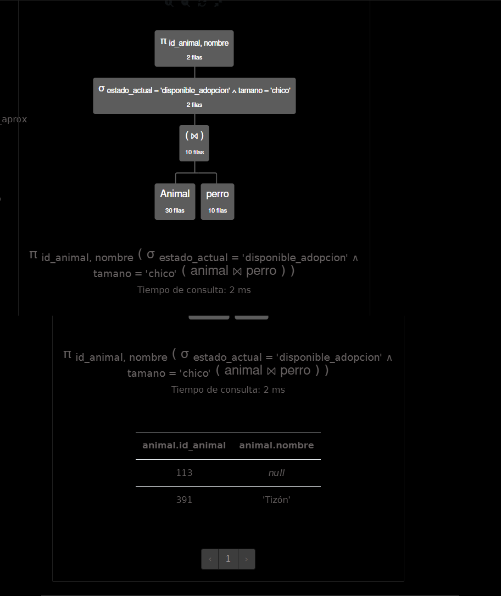
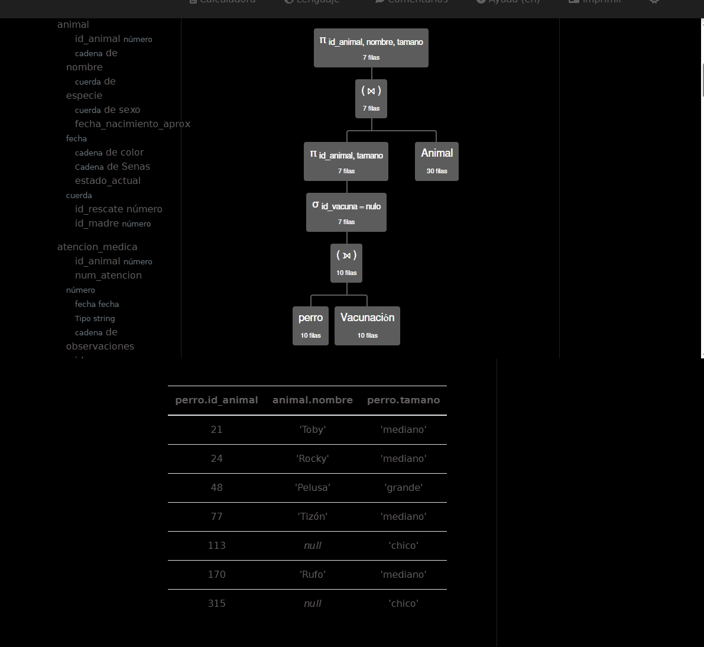
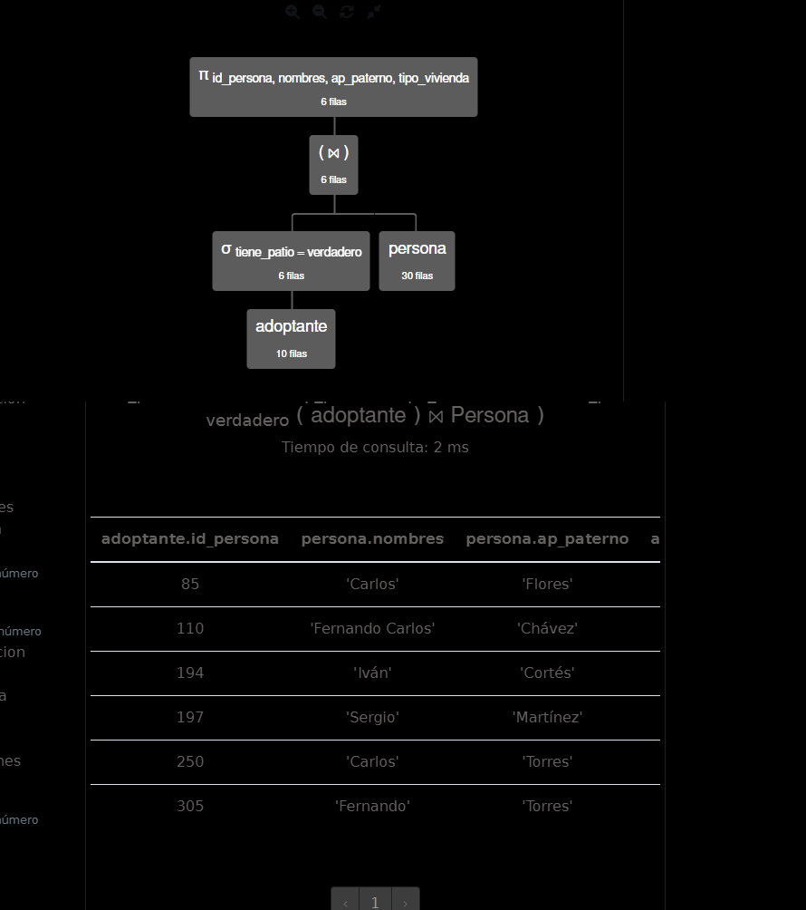

# Trabajo individual — Alejandro Rojas

**Autor:** Alejandro Rojas.  
**Estado:** completo; consultas comprobadas en RelaX y en SQL con la misma muestra.

**Archivo SQL:** [alejandro-rojas.sql](alejandro-rojas.sql).  
**Datos:** muestra de HuellaRed del grupo RelaX de Gael ([grupo.txt](../relax/grupo.txt), 23 tablas, 348 filas). El SQL
se comprobó con [muestra.sql](../relax/muestra.sql), que crea tablas temporales con exactamente las mismas filas, y
consultando sin el prefijo `public.`. Los resultados describen la muestra, no la base completa.
Preguntas enviadas a Gael para reservarlas y no repetir las del equipo. La consulta 2 usa **reunión externa**.

## Consulta 1 — Perros chicos disponibles para adopción

- **Pregunta del dominio:** ¿Qué perros de tamaño chico están disponibles para adopción?
- **Operadores:** reunión natural (⋈), selección (σ) y proyección (π).
- **Expresión algebraica:**

```text
Perros    ← animal ⋈ perro
Filtrados ← σ estado_actual = 'disponible_adopcion' ∧ tamano = 'chico' (Perros)
Resultado ← π id_animal, nombre (Filtrados)
```

**Explicación.** `animal` tiene los datos generales (nombre, estado) y `perro` los datos propios de los perros, como el
tamaño. La reunión las junta por `id_animal`, su único atributo en común; solo quedan los animales que son perros. La
selección deja a los que están disponibles **y** son de tamaño chico (el esquema maneja chico, mediano y grande). La
proyección muestra solo el id y el nombre.

- **SQL equivalente:**

```sql
SELECT a.id_animal, a.nombre
FROM animal a
JOIN perro p ON p.id_animal = a.id_animal
WHERE a.estado_actual = 'disponible_adopcion'
  AND p.tamano = 'chico'
ORDER BY a.id_animal;
```

- **Captura de RelaX con árbol y resultado:**


- **Resultado y comparación:** RelaX y SQL devuelven las mismas 2 filas: el perro 113 (sin nombre registrado, `NULL`)
  y el 391, Tizón. En la muestra hay 4 perros chicos, pero 194 y 315 ya están adoptados. En la base completa la misma
  consulta da 12 perros.

## Consulta 2 — Perros que nunca han sido vacunados

- **Pregunta del dominio:** ¿Qué perros nunca han recibido ninguna vacuna?
- **Operadores:** reunión externa izquierda (⟕), selección (σ), proyección (π) y reunión natural (⋈).
- **Expresión algebraica:**

```text
ConVacunas ← perro ⟕ vacunacion
SinVacuna  ← π id_animal, tamano (σ id_vacuna = null (ConVacunas))
Resultado  ← π id_animal, nombre, tamano (SinVacuna ⋈ animal)
```

**Explicación.** La reunión externa izquierda conserva **a todos** los perros, aunque no tengan vacunas. Comparten solo
`id_animal`. Un perro con vacunas aparece una vez por cada vacuna. A un perro sin vacunas se le quedan vacías (`NULL`)
las columnas de `vacunacion`, y la selección `id_vacuna = null` se queda solo con esos perros. Si se usara una reunión
normal (⋈), esos perros desaparecerían y no se podrían encontrar. Al final se reúne con `animal` para mostrar el nombre.

- **SQL equivalente:**

```sql
SELECT a.id_animal, a.nombre, p.tamano
FROM perro p
LEFT JOIN vacunacion v ON v.id_animal = p.id_animal
JOIN animal a ON a.id_animal = p.id_animal
WHERE v.id_vacuna IS NULL
ORDER BY a.id_animal;
```

- **Captura de RelaX con árbol y resultado:**


- **Resultado y comparación:** RelaX y SQL devuelven las mismas 7 filas: 21 Toby, 24 Rocky, 48 Pelusa, 77 Tizón, 113
  (sin nombre), 170 Rufo y 315 (sin nombre). De los 10 perros de la muestra, solo 11, 194 y 391 tienen vacunas. En la
  base completa son 88 de 240 perros.

## Consulta 3 — Adoptantes con patio

- **Pregunta del dominio:** ¿Qué adoptantes tienen patio en su casa?
- **Operadores:** selección (σ), reunión natural (⋈) y proyección (π).
- **Expresión algebraica:**

```text
ConPatio  ← σ tiene_patio = true (adoptante)
Resultado ← π id_persona, nombres, ap_paterno, tipo_vivienda (ConPatio ⋈ persona)
```

**Explicación.** `adoptante` guarda los datos de la vivienda, y `persona` el nombre. Primero la selección deja solo a
los adoptantes con patio; después la reunión natural, por `id_persona`, les agrega el nombre. La proyección muestra el
nombre y el tipo de vivienda. Filtrar antes de reunir da el mismo resultado que reunir y luego filtrar, pero junta menos
filas.

- **SQL equivalente:**

```sql
SELECT p.id_persona, p.nombres, p.ap_paterno, d.tipo_vivienda
FROM adoptante d
JOIN persona p ON p.id_persona = d.id_persona
WHERE d.tiene_patio = TRUE
ORDER BY p.id_persona;
```

- **Captura de RelaX con árbol y resultado:**


- **Resultado y comparación:** RelaX y SQL devuelven las mismas 6 filas: 85 Carlos Flores, 110 Fernando Carlos Chávez,
  194 Iván Cortés, 197 Sergio Martínez, 250 Carlos Torres y 305 Fernando Torres. Cuatro viven en casa y dos en
  departamento. En la base completa son 140 de 260 adoptantes.

`ORDER BY` aparece solo en SQL para presentar el resultado ordenado. No cambia qué filas se devuelven, y en RelaX se
omite. En RelaX el filtro de la consulta 2 se escribe `id_vacuna = null`; en SQL, `IS NULL`.

## Explicación de una descomposición

Tomo la descomposición del ejercicio 1.3 de [normalizacion.md](../normalizacion.md), la de la tabla desnormalizada
`rescate_zona`.

**Relación original.** D = (id_rescate, descripcion_lugar, fecha_hora, condicion_inicial, tipo_ingreso, id_zona,
colonia, municipio, entidad). Es una sola tabla donde cada fila es un rescate y lleva copiados los datos de su zona.

**Dependencias y clave.** El rescate determina sus datos y su zona (`id_rescate → descripcion_lugar, fecha_hora,
condicion_inicial, tipo_ingreso, id_zona`). La zona determina sus nombres (`id_zona → colonia, municipio, entidad`) y
al revés (`colonia, municipio, entidad → id_zona`). La única clave es `id_rescate`, porque ningún otro atributo
determina los datos del rescate.

**Dependencia problemática.** `id_zona → colonia, municipio, entidad`. Su determinante (`id_zona`) no es clave de D,
así que D está en 2FN pero no en 3FN ni BCNF: hay una dependencia transitiva `id_rescate → id_zona → colonia`. En la
práctica, si una zona tiene 10 rescates, su colonia está escrita 10 veces. Para corregir un nombre hay que cambiar 10
filas (anomalía de actualización). No se puede guardar una zona que todavía no tiene rescates (anomalía de inserción).
Y si se borra el último rescate de una zona, se pierden sus datos (anomalía de eliminación).

**Relaciones resultantes.**
1. ZONA_N(**id_zona**, colonia, municipio, entidad), con clave `id_zona` (y también la combinación de los tres nombres).
2. RESCATE_N(**id_rescate**, descripcion_lugar, fecha_hora, condicion_inicial, tipo_ingreso, id_zona), con FK a ZONA_N.

Las dos quedan en BCNF, porque en cada una todo determinante es clave.

**Reunión sin pérdida.** Las dos tablas comparten solo `id_zona`, y `id_zona` es clave de ZONA_N. Por la regla de
descomposición binaria (la intersección determina toda una de las partes), al reunirlas por `id_zona` cada rescate se
empareja exactamente con su zona: no aparecen filas inventadas ni se pierden filas. La migración 003 lo comprobó con
los datos: la reconstrucción tiene las mismas 420 filas que D.

**Preservación de dependencias.** Cada dependencia cabe completa en una de las tablas: las del rescate en RESCATE_N y
las de la zona en ZONA_N. Se pueden verificar sin reunir tablas, y `id_rescate → colonia` se sigue obteniendo por
transitividad.

## Defensa

Modificaciones preparadas, con los datos de la muestra: en la consulta 1, si se quita la condición de
`disponible_adopcion`, el resultado pasa de 2 a 4 perros, porque entran los perros chicos ya adoptados (194 y 315). En
la consulta 2, si se cambia `⟕` por `⨝`, el resultado queda vacío, porque la reunión normal elimina justo a los perros
sin vacunas. En la consulta 3, si se cambia `tiene_patio = true` por `false`, salen los otros 4 adoptantes (106, 158,
240 y 297).

**Firma:** Alejandro Rojas.
